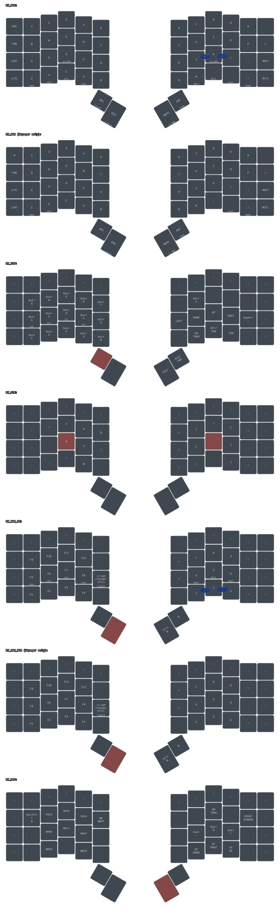

# kōyō


- [Introduction](#introduction)
- [Features](#features)
- [CLI Tool](#cli-tool)
- [macOS Settings](#macos-settings)
- [Layout](#layout)
- [Project Structure](#project-structure)
- [Prerequisites](#prerequisites)
- [Development](#development)
    - [Adding New Features](#adding-new-features)
    - [Testing](#testing)
- [Roadmap](#roadmap)
- [Resources](#resources)
- [Contributing](#contributing)
- [License](#license)

## Introduction

**kōyō** is a sleek, minimalistic keyboard layout, designed with a 36-key split configuration. Its name is inspired by the harmony and elegance of Japanese aesthetics and the calming feeling of autumn leaves.

> In Japanese, **kōyō (紅葉)** translates to "autumn leaves" and is used to describe the phenomenon of leaves changing color in the autumn season. The word is composed of two kanji characters: **kō (紅)** meaning "crimson" and **yō (葉)** meaning "leaf".

## Note

> [!NOTE]
> The layout in its current form is mainly focused for use in combination with MacOS.
> It can work on other operating systems, but the layout may not be optimized for them.
> In the future, I (hopefully) will be working on optimizing the layout for other operating systems.

## Features

### Core Layout

- QWERTY Base: Familiar layout to ease the transition while maintaining efficiency
- Compact 36-Key Design: Optimized for minimal finger movement and maximum ergonomics
- Strategic Alpha Placement: Bottom row alphas remain easily accessible without blocking home row access

### Layer Design

- Extended layer under space bar for frequently used tools
- Symbol layer with semantic arrangement
- Unified NUM_FN layer combining numbers and function keys for efficient access
- Gaming layer on the Voyager, toggled by holding the left outer thumb and pressing the left Shift key

### Thumb Cluster Philosophy

- Reserved for high-frequency, single-action keys (Space, Enter)
- Dual-purpose modifiers (HYPER) integrated with common actions
- Minimal thumb usage - only middle thumb keys are active to reduce fatigue
- Backspace on the right thumb: tap for Backspace, hold for the MED layer

### Navigation & Tools

- Vim-Inspired Navigation:
    - Arrow keys in familiar HJKL pattern
    - Navigation shortcuts following vim metaphors
        - `[` & `]` for often used navigation bindings are combos on the base layer
    - Extended layer provides quick access to common movements
- Efficient Symbol Access:
    - Symbols arranged in semantic pairs for intuitive access
    - Common programming symbols placed at strongest fingers
    - Consistent access pattern across both hands

### Special Features

- Integrated Shortcuts:
    - Quick access to common GUI commands
        - e.g. Put common GUI commands on left hand split to enable one hand use in combination with the right hand on mouse
    - Tab and window management controls
    - Media and system controls in dedicated layer
- Smart Mod-Taps:
    - Dual-function keys for extended capabilities
    - Context-aware modifier combinations
    - Reduced finger travel for common operations

### Quality of Life

- Chordal Hold: Smart handling of hold-tap actions
- Cross-Platform Compatibility: Works seamlessly across operating systems
- Customizable Function Layer: Easy access to F-keys and system functions

## Layout



[`keymap.yml`](./keymap.yml) is the source of truth for every board. It describes each layer in QMK keycodes on the Voyager shape: the 3x5 core, the outer ring and two thumbs per side. To change the layout, edit `keymap.yml` and run:

```bash
koyo update keymap
```

This writes `qmk/<board>/src/keymap.generated.h` for every board (Corne and Chocofi use the core and thumbs, Moonlander and Voyager the outer ring too) and redraws the graphic above. Flashing runs it as well. `koyo check` verifies the result and runs as a Git pre-push hook, which `./koyo setup` installs through Lefthook (from `mise.toml`). `keymap.yml` also sets the lighting: a background colour per layer and highlights for key groups, generated into the same headers. `qmk/shared/` holds the behaviour of every board: mod-tap overrides, chordal hold and tapping terms. Each board's `keymap.c` holds only what differs per board.

## CLI Tool

The `koyo` CLI tool provides a streamlined interface for managing your keyboard configurations:

### Installation

```bash
# Clone the repository
git clone https://github.com/nikbrunner/koyo.git

# Run the setup script
./setup.sh
```

### Commands

#### Setup

```bash
# Standard setup
koyo setup

# Dry run to see what would happen
koyo setup --dry-run
```

#### Keyboard Operations

```bash
# Flash Moonlander keyboard
koyo moonlander flash

# Open Moonlander configuration in Oryx
koyo moonlander oryx

# Flash Corne keyboard
koyo crkbd flash

# Flash Voyager keyboard
koyo voyager flash
```

#### Update Operations

```bash
# Generate board keymaps and the layout SVG from keymap.yml
koyo update keymap

# Verify generated files, key mapping, hand-written cases and that every board compiles
koyo check

# Update QMK firmware
koyo update qmk
```

### Debug Mode

Add the `--debug` or `-d` flag to any command for verbose output:

```bash
koyo --debug moonlander flash
```

## macOS Settings

`koyo macos` applies these settings. Log out and back in afterwards so every app picks them up.

| Setting                                    | Value    | Where to set it by hand                                                                            | Effect                                                                                                                                                                      |
| ------------------------------------------ | -------- | -------------------------------------------------------------------------------------------------- | --------------------------------------------------------------------------------------------------------------------------------------------------------------------------- |
| `com.apple.keyboard.fnState`               | `true`   | Keyboard → Keyboard Shortcuts… → Function Keys → "Use F1, F2, etc. keys as standard function keys" | F-keys send F1, F2 and so on. Hold `fn` for the media action.                                                                                                               |
| `KeyRepeat`                                | `2`      | Keyboard → Key repeat rate, fastest                                                                | Repeat speed once a held key starts repeating                                                                                                                               |
| `InitialKeyRepeat`                         | `15`     | Keyboard → Delay until repeat, shortest                                                            | Wait before a held key starts repeating                                                                                                                                     |
| `ApplePressAndHoldEnabled`                 | `false`  | Terminal only                                                                                      | A held key repeats instead of opening the accent popup, so holding `j` keeps moving in Vim. Umlauts stay on Option+U.                                                       |
| `AppleSymbolicHotKeys` (IDs in `macos.sh`) | disabled | Keyboard → Keyboard Shortcuts…, in Mission Control, Screenshots, Input Sources and Accessibility   | System shortcuts for zoom, screenshots, Mission Control, show desktop, input source and Spaces stop catching keys meant for Karabiner and apps, such as F12 and Ctrl+Arrow. |

## Project Structure

```
koyo/
├── assets/            # Project assets
├── qmk/               # QMK configurations
│   ├── moonlander/    # Moonlander specific files
│   ├── crkbd/         # Corne specific files
│   ├── chocofi/       # Chocofi specific files
│   ├── voyager/       # Voyager specific files
│   ├── shared/        # Behaviour of every board
│   └── flash.sh       # Builds and flashes one board
├── setup.sh           # Setup script
├── utils.sh           # Utility functions
├── help.sh            # Help documentation
├── keymap.yml         # Keymap for all boards (source of truth)
├── generate_keymap.py # keymap.yml → board headers and drawing input
├── test_generate_keymap.py # Checks where keys land on each board
├── update_keymap.sh   # Keymap and SVG update script
├── check.sh           # Verifies generated files and builds every board
├── macos.sh           # Applies the macOS keyboard settings
├── lefthook.yml       # Git hooks (pre-push runs check.sh)
├── config.yml         # Configuration file
└── koyo               # koyo command
```

## Prerequisites

The setup script will automatically install missing dependencies:

- **Homebrew** - Required for installing other dependencies (install from [brew.sh](https://brew.sh))
- **git** - For cloning repositories

The following are installed automatically by `./koyo setup`:

- **QMK CLI** - Installed via [official installer](https://docs.qmk.fm/newbs_getting_started)
- **QMK Firmware** - Cloned to `~/repos/qmk/qmk_firmware`
- **yq** - YAML processing (via Homebrew)
- **pipx** - Python package manager (via Homebrew)
- **keymap-drawer** - SVG generation (via pipx)
- **python3** - Runs the keymap generator (standard library only)

## Development

### Adding New Features

1. Create a new branch for your feature
2. Implement your changes
3. Update documentation if necessary
4. Submit a pull request

### Testing

Before submitting changes:

1. Test all keyboard configurations
2. Verify CLI commands work as expected
3. Run setup script in dry-run mode

## Roadmap

- [x] `koyo moonlander flash` (Flashes the Moonlander Keybaord)
- [x] `koyo setup` (Sets up Prerequisites)
- [x] DRY up scripts
- [x] `koyo moonlander oryx` (Opens up Oryx Configurator Page)
- [x] `koyo crkbd flash` (Flashes the Corne Keyboard)
- [x] `koyo voyager flash` (Flashes the Voyager Keyboard)
- [x] `koyo update keymap` (Generates board keymaps and the SVG from `keymap.yml`)
- [x] `koyo update qmk` (Pulls latest Version of QMK firmware)
- [x] Ensure keymap-drawer is installed
- [x] Align layouts & purge unused or redundant stuff
- [x] Document differences between kōyō for CRKBD and Moonlander
- [x] Add note about current optimizations focused on MacOS
- [ ] Optimize Home Row Mods for MacOS
- [ ] Make Layout SVG OS agnostic
- [x] Script to automatically update SVG
- [x] SSOT for keymap. Script to generate `keymap.c` files from SSOT.

## Resources

- [urob](https://github.com/urob/zmk-config): timeless home row mods
- [infused-kim](https://github.com/infused-kim/zmk-config)
- [miryoku_zmk](https://github.com/manna-harbour/miryoku_zmk)
- [ZMK Docs](https://zmk.dev/docs)
- [Designing a Symbol Layer](https://getreuer.info/posts/keyboards/symbol-layer/index.html)
- [A guide to home row mods](https://precondition.github.io/home-row-mods#shift-thumb-keys)
- [Callum Mods](https://github.com/callum-oakley/qmk_firmware/tree/master/users/callum)
- [Jonas Hietala: I designed my own keyboard layout. Was it worth it?](https://www.jonashietala.se/blog/2023/11/02/i_designed_my_own_keyboard_layout_was_it_worth_it/)

## Contributing

Contributions are welcome! Please read through the existing issues and pull requests before creating new ones.

## License

This project is licensed under the MIT License - see the LICENSE file for details.
